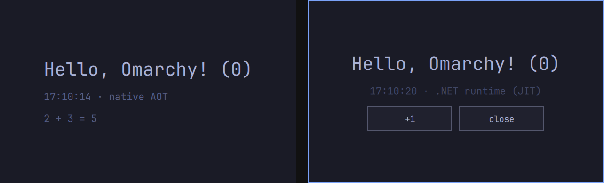

# hello

One `Backend.cs` used two ways: as a window app (left, native AOT) and as an omarchy-shell panel (right, the C# runs as a child process).



```sh
dotnet watch                                           # the window app, with live QML and C# edits
sh ../../template/.agents/skills/omasharp/scripts/check.sh   # checked off-screen (OmarchyKind=panel sh ... for the panel)
dotnet publish -p:OmarchyKind=panel -t:Install         # the panel; open it with: omarchy-shell shell toggle omasharp-hello
```

It also covers the bridge's edge cases: async methods (`CountSlowly`), a call that throws (`Fail`), a timer on a background thread (`Time`), and a deliberate crash (`Crash`) to show that a panel survives its backend dying.

It uses the repo's `../../template/bridge` directly. Apps made with the template get their own copy instead.
