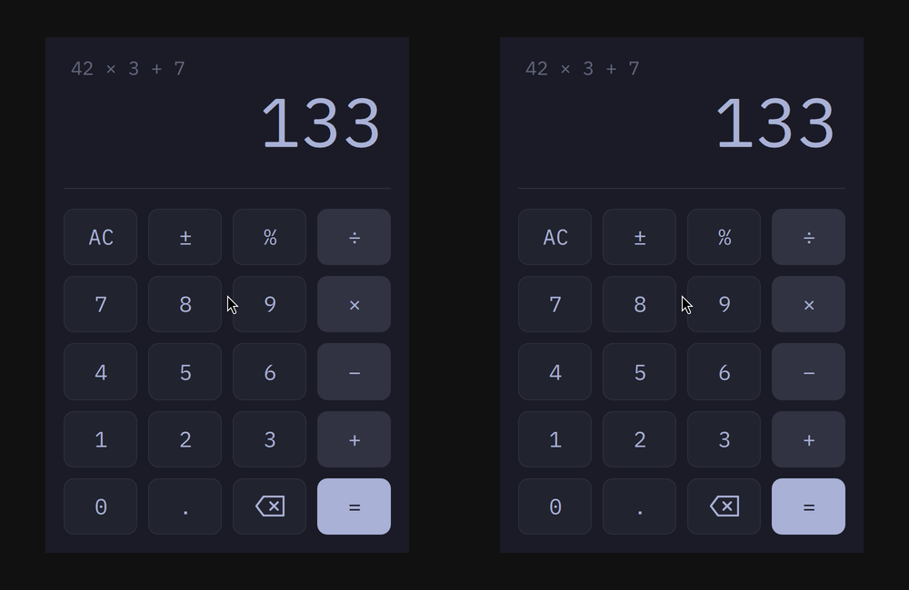

# omacalc

Omarchy's calculator ([omacom/omacalc](https://github.com/omacom/omacalc)) ported to C#. The C++ backend became `Backend.cs`; the QML is omacalc's, lightly adapted; `tests/` is omacalc's test suite in C#.

```sh
dotnet run --project tests        # omacalc's tests
sh ../../template/.agents/skills/omasharp/scripts/check.sh   # checked off-screen
dotnet publish -t:Install         # ~/.local/bin/omasharp-calc + a launcher entry
```

Its AppId is `omasharp-calc`, so installing it leaves Omarchy's own omacalc alone. Omarchy floats the real one with a window rule; to float this one too, add `o.window("omasharp-calc", { float = true })` to your Hyprland config.

## Against the original

Omarchy's C++ omacalc (left) and this example (right), typing `42*3+7=` into each. Medians of 7 interleaved runs on one Omarchy laptop; rerun them with `tools/bench.sh`.



| | C++ | omasharp |
|---|---|---|
| Time to window, median (range) | 618 ms (555–1,053) | 593 ms (514–1,383) |
| RSS / PSS | 120.6 / 74.6 MB | 123.8 / 77.8 MB |
| Threads | 18 | 22 |
| Idle CPU, wake-ups/s | 0‰, 3 | 0‰, 3 |
| Close | 113 ms | 115 ms |
| On disk | 0.30 MB | 3.47 MB |
| Needs at run time | Qt | Qt |

## License

omacalc is MIT, Copyright (c) 2026 David Heinemeier Hansson: see [LICENSE](LICENSE). The font, iA Writer Mono S, is under the [SIL Open Font License](fonts/OFL.txt).
