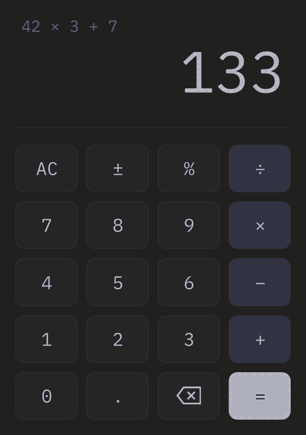
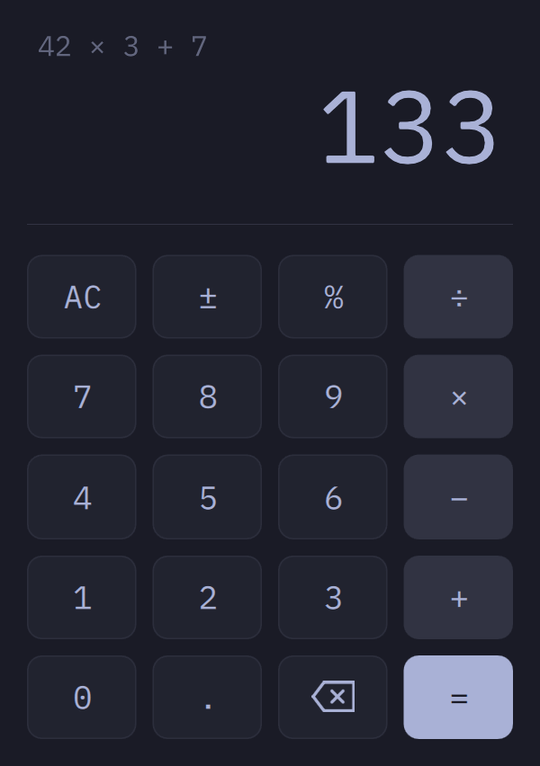

# omacalc

Omarchy's calculator ([omacom/omacalc](https://github.com/omacom/omacalc)) ported to C#. `Backend.cs` replaces the C++ backend. The QML is omacalc's with small changes, and `tests/` is omacalc's test suite translated to C#.

```sh
dotnet run --project tests                                  # omacalc's tests
sh ../../template/.agents/skills/omasharp/scripts/check.sh  # runs it off-screen and checks it
dotnet publish -t:Install                                   # installs ~/.local/bin/omasharp-calc and a launcher entry
```

Its app id is `omasharp-calc`, so installing it leaves Omarchy's own omacalc alone. Omarchy floats the real omacalc with a window rule. To float this one too, add `o.window("omasharp-calc", { float = true })` to your Hyprland config.

## Theming

It follows the Omarchy theme and repaints as soon as you switch:



## Against the original

Both calculators after typing `42*3+7=`. The numbers are medians of 7 interleaved runs on one Omarchy laptop. `tools/bench.sh` reruns them.

| | omacalc (C++) | Omasharp (C#) |
|---|---|---|
| |  |  |
| Time to window, median (range) | 618 ms (555–1,053) | 593 ms (514–1,383) |
| RSS / PSS | 120.6 / 74.6 MB | 123.8 / 77.8 MB |
| Threads | 18 | 22 |
| Idle CPU, wake-ups/s | 0‰, 3 | 0‰, 3 |
| Close | 113 ms | 115 ms |
| On disk | 0.30 MB | 3.47 MB |
| Needs at run time | Qt | Qt |

## License

omacalc is MIT, Copyright (c) 2026 David Heinemeier Hansson. See [LICENSE](LICENSE). Its font, iA Writer Mono S, uses the [SIL Open Font License](fonts/OFL.txt).
