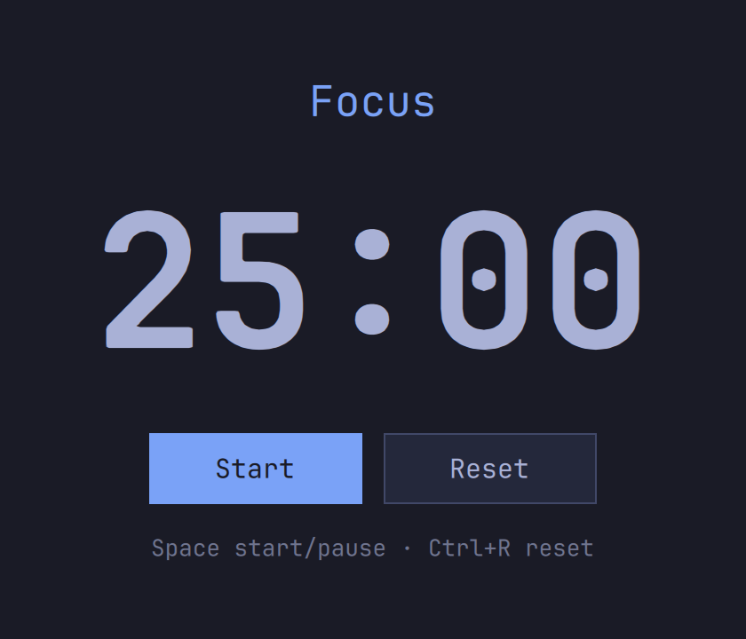

# pomodoro

A pomodoro timer: 25-minute focus sessions, 5-minute breaks, a big countdown, and a notification when each session ends. Space starts and pauses, Ctrl+R resets.



```sh
dotnet run --project tests                                  # the tests
sh ../../template/.agents/skills/omasharp/scripts/check.sh  # runs it off-screen and checks it
dotnet publish -t:Install                                   # installs ~/.local/bin/omasharp-pomodoro and a launcher entry
```

- `Backend` takes its clock as a `Func<DateTime>`, so the tests step through a whole focus session and break without waiting.
- QML only asks for a fresh countdown while the timer runs (`Tick()`); C# keeps the end time, so a slow frame never loses a second.
- The end-of-session alert runs `notify-send`, and the tests swap it out.

It uses the repo's `../../template/bridge` directly. Apps made from the template get their own copy instead.
