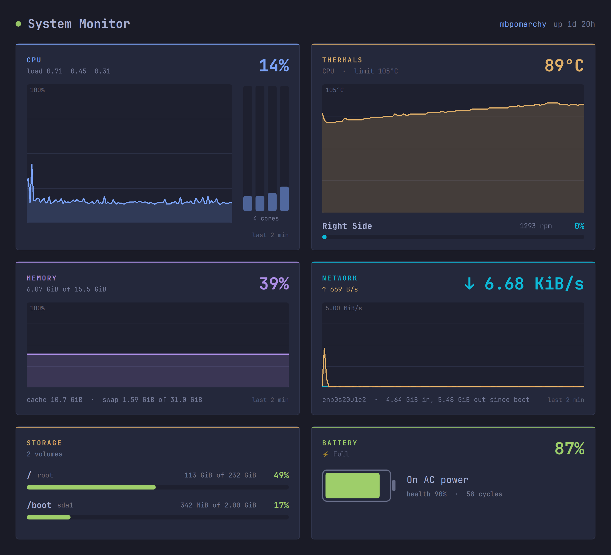

# systemmonitor

A system monitor: CPU (overall and per core), temperature and fans, memory, network, storage and battery, refreshed every second in the Omarchy theme.



```sh
dotnet run --project tests                                  # the tests
sh ../../template/.agents/skills/omasharp/scripts/check.sh  # runs it off-screen and checks it
dotnet publish -t:Install                                   # installs ~/.local/bin/omasharp-systemmonitor and a launcher entry
```

- **Graphs drawn in C#.** `Graph.cs` draws each graph as an `Area` under a `Polyline` in a `Drawing`, and `DrawView` shows it. QML tells the backend each graph's size (`Resize`), so the drawing fits it exactly. They redraw when the theme changes.
- **Plain parsers.** `Probe.cs` reads `/proc` and `/sys` with pure functions, so the tests feed them sample text. The tests also take a few real readings from the machine they run on.
- **Records in QML.** Per-core load, disks and fans are C# records (`CoreLoad`, `DiskUsage`, `FanSpeed`), and QML gets them as JS objects.
- **Fits half a screen.** Tiled next to another window, it switches to a compact layout.

It uses the repo's `../../template/bridge` directly. Apps made from the template get their own copy instead.
